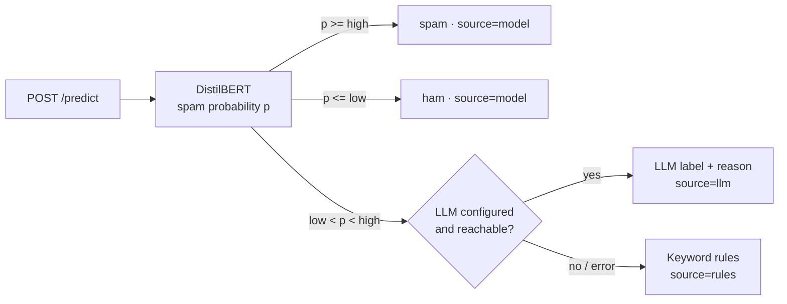

# Email Filtering Using DistilBERT
 


 
This started as a small project: fine-tune DistilBERT to catch spam, put it behind an API, and
ask an LLM whenever the model isn't sure. When I came back to it later, I realised I had never
checked whether any of that was worth it. Is a transformer actually better than a simple model
here? Does the LLM fallback help? And when the model explains a decision, can I believe it?
 
So I rebuilt it properly and measured everything. Some of the answers surprised me.
 
## What I found
 
I expected the fine-tuned DistilBERT to win clearly. It didn't. On the Enron test set every
model I trained landed at an F1 of about 0.99, and plain Naive Bayes flagged the fewest
legitimate emails (0.8%, against 0.9% for DistilBERT). Naive Bayes trains in 16 seconds on a
CPU. DistilBERT took 27 minutes on a GPU and is roughly 20 to 30 times slower per email.
 
The real problem showed up when I tested on modern emails that none of the models had seen.
They all still caught over 99% of the phishing, but they also marked a lot of normal email as
spam: about a quarter of it for the classical models, and 37% for DistilBERT.
 
The explainability tools I had built told me why. The words pushing hardest towards "not spam"
were *enron*, *vince*, *kaminski*, *daren* and *hpl*, names and jargon from one company in the
early 2000s. The model had basically learned that anything that looks like Enron is safe, and
anything else is suspicious.
 
I then tried a free open-weight LLM (Qwen2.5-3B, running locally on the GPU, no training at
all) to see whether a model without that Enron bias would do better. It caught the spam too,
but it flagged 47% of the legitimate Enron emails and 74% of the modern ones. So that wasn't
the answer either.
 
My LLM fallback never fired once. It only steps in when the model is unsure, and on modern
email the model wasn't unsure, it was confidently wrong. That was the most useful lesson for
me: a confidence threshold can't protect you from data that has changed.
 
If I had to ship this today, I'd put logistic regression or Naive Bayes behind the same API.
They're just as accurate on this data and far cheaper to run. For modern email, the fix is
newer training data, and a bigger model won't make up for that.
 
<p align="center">
  
</p>
<p align="center"><sub>A real explanation from the trained model. Red words pushed it towards spam, blue towards ham.
You can see a lot of weight landing on everyday words like <i>you</i> and <i>the</i>, which matches what the faithfulness tests found.</sub></p>

## The numbers
 
Every model was scored on the same emails: the 2,000-email Enron-Spam test set, and 2,000
emails from a modern phishing dataset (769 phishing, 1,231 safe) that no model was trained on.
All of it ran on a free Colab T4 GPU.
 
| Model | Enron F1 | Enron: real emails flagged | Modern: real emails flagged | Modern: phishing caught | ms per email | Training |
| --- | ---: | ---: | ---: | ---: | ---: | ---: |
| Naive Bayes | 0.990 | 0.8% | 23.2% | 99.2% | 0.6 | 16 s |
| Linear SVM (TF-IDF) | 0.989 | 1.6% | 25.2% | 99.6% | 0.4 | 17 s |
| Logistic regression (TF-IDF) | 0.986 | 1.9% | 22.6% | 99.5% | 0.4 | 18 s |
| DistilBERT, fine-tuned | 0.992 | 0.9% | 37.4% | 99.6% | 10.4 | 27 min |
 
The local LLM takes about half a second per email, so I ran it on a random 200 emails from
each set and scored the other models on exactly the same ones:
 
| Model (same 400 emails) | Enron F1 | Enron: real emails flagged | Modern: real emails flagged | Modern: phishing caught |
| --- | ---: | ---: | ---: | ---: |
| Logistic regression (TF-IDF) | 0.981 | 3.1% | 18.2% | 98.7% |
| DistilBERT, fine-tuned | 0.986 | 2.1% | 38.0% | 98.7% |
| Qwen2.5-3B-Instruct, zero-shot | 0.817 | 46.9% | 74.4% | 97.5% |
 
To be fair to the LLM, I used the same prompt as the API fallback and didn't tune it, and 3B is
a small model. A bigger model with a few examples in the prompt would probably do better. Still,
the result lines up with research showing that small fine-tuned models usually beat zero-shot
LLMs at classification.
 
Before training anything I wrote down 17 KPIs with targets, so I couldn't move the goalposts
afterwards. 9 passed, 3 missed, 3 need a human to look at them, and 2 couldn't be measured
because no email ever reached the LLM.
 
<details>
<summary>All 17 KPIs</summary>
| Group | KPI | Target | Result |
| --- | --- | ---: | ---: |
| Quality | Real emails marked as spam | ≤ 1% | 0.9%, pass |
| Quality | Spam caught (recall) | ≥ 95% | 99.2%, pass |
| Quality | F1, full system | ≥ 95% | 99.2%, pass |
| Quality | F1, model alone (validation) | ≥ 95% | 99.5%, pass |
| Hybrid design | Accuracy gain from the LLM on uncertain emails | ≥ 0 pp | not measured (no uncertain emails) |
| Hybrid design | Emails sent to the LLM | ≤ 15% | 0%, pass |
| Hybrid design | Emails falling back to rules | ≤ 1% | 0%, pass |
| Operations | Latency p95, model path (T4 GPU) | ≤ 300 ms | 165 ms, pass |
| Operations | Latency p95, LLM path | ≤ 3 s | not measured (no LLM calls) |
| Operations | LLM cost per 1,000 emails | ≤ $0.10 | $0, pass |
| Explainability | IG completeness error (mean) | ≤ 0.05 | 0.159, miss |
| Explainability | Top-5 comprehensiveness minus random | ≥ 0.10 | 0.009, miss |
| Explainability | Explanations beating random (top-5) | ≥ 80% | 57%, miss |
| Explainability | Top-5 sufficiency | ≤ 0.20 | 0.092, pass |
| Explainability | Shortcut words | reviewed | 12 flagged, all Enron names and jargon |
| Robustness | Modern phishing caught | tracked | 99.6% |
| Robustness | Safe modern emails marked as spam | tracked | 36.6% |
 
The full reports are in [`reports/`](reports): [KPIs](reports/kpis.md),
[explainability](reports/explainability.md), [benchmark](reports/benchmark.md) and the
[training metrics](reports/model/metrics.json).
 
</details>

## How it works
 
An email goes to DistilBERT first. If the spam probability is clearly high or clearly low, that's
the answer. If it falls in between, the email goes to an LLM (Azure OpenAI or OpenAI) for a second
opinion, and if no LLM is available, a few keyword rules decide.
 

 
The "unsure" band is picked on the validation set, so that whatever the model decides alone is
at least 99% precise for both spam and ham. On Enron the model already hit that everywhere, so
the band shrank to a single cut-off at 0.57, which is why nothing went to the LLM. Training and
the API share the same text cleaning code, so the model sees the same input in both places.
 
## The explanations, and where they fall short
 
You can ask the API to explain a decision (`/predict?explain=true`). It uses Integrated
Gradients, which measures how much each word moved the spam probability. I didn't use attention
weights, because they show where the model looks, not what changes its mind.
 
I didn't want to just trust the explanations, so I tested them, and they're only partly
reliable. Keeping just the top 5 words mostly preserves the prediction, which is good. But
removing those 5 words barely changes it, hardly more than removing 5 random words. The model is
so confident (probabilities right at 0 or 1) that taking out a few words doesn't move it. The
attributions also don't add up as precisely as they should, probably because 32 integration
steps is too few. The shortcut audit, on the other hand, turned out to be the most useful part
of the whole project, since it's what exposed the Enron bias.
 
## What's left
 
- Retrain on a mix of Enron and recent email and run the benchmark again. This is the obvious
  next step for the false alarms on modern email.
- Send emails that look unlike the training data to the LLM, instead of only the ones the model
  is unsure about.
- Try a bigger open model (7–8B) with a few-shot prompt.
- Run Integrated Gradients with more steps, and measure faithfulness on logits instead of
  probabilities.
- Put up a small public demo.
## Try it yourself
 
The easiest way is Google Colab, no API key needed. Upload
[`notebooks/train_and_evaluate.ipynb`](notebooks/train_and_evaluate.ipynb) to train the model and
measure every KPI (about 40 minutes on a free T4), then
[`notebooks/benchmark.ipynb`](notebooks/benchmark.ipynb) for the model comparison (about 15 minutes).
 
To run it locally (Python 3.12 or 3.13, a GPU helps):
 
```bash
git clone https://github.com/namita-tj/Email-Filtering-Using-DistilBERT
cd Email-Filtering-Using-DistilBERT
pip install -r requirements.txt -r training/requirements.txt
 
python -m training.train              # fine-tune DistilBERT on Enron-Spam
python -m evaluation.run --phishing   # all KPIs (add --no-llm to skip API calls)
python -m training.benchmark --local-llm Qwen/Qwen2.5-3B-Instruct   # the comparison, needs PyTorch
```
 
`TRAIN_LIMIT=2000` gives you a quick trial run, and `python -m training.baseline` trains the
TF-IDF baseline in under a minute on a CPU.
 
To serve the API, copy `.env.example` to `.env`, then run `uvicorn app.main:app --reload` or
`docker compose up --build`, and open http://localhost:8000/docs.
 
```bash
curl -X POST "http://localhost:8000/predict?explain=true&top_k=3" \
  -H "Content-Type: application/json" \
  -d '{"subject": "Account locked", "text": "Verify your password within 24 hours."}'
```
 
The response tells you the label, the spam probability, which stage decided (`model`, `llm` or
`rules`) and, if you asked for it, the words that mattered most. `GET /health` shows whether the
model is loaded and whether the LLM fallback is on.
 
<details>
<summary>Configuration</summary>
Everything is set through environment variables, and [`.env.example`](.env.example) lists them all.
 
| Variable | What it does |
| --- | --- |
| `MODEL_DIR` | Folder with the trained model (default `spam_detection_model`) |
| `S3_BUCKET`, `S3_PREFIX` | Where to download the model from if `MODEL_DIR` is empty |
| `LLM_PROVIDER` | `azure`, `openai` or `none`; picked from the credentials if left empty |
| `AZURE_OPENAI_ENDPOINT`, `AZURE_OPENAI_API_KEY`, `AZURE_OPENAI_DEPLOYMENT` | Azure OpenAI fallback |
| `OPENAI_API_KEY`, `OPENAI_MODEL` | OpenAI fallback (default `gpt-4o-mini`) |
| `LOW_THRESHOLD`, `HIGH_THRESHOLD` | Override the unsure band from training |
| `LLM_TIMEOUT_SECONDS`, `LOG_LEVEL` | LLM timeout and log level |
 
</details>
<details>
<summary>Development and project layout</summary>
The tests use stand-ins for the model and the LLM, so they run in a few seconds without a GPU
or API keys:
 
```bash
pip install -r requirements-dev.txt
ruff check .
pytest --cov
```
 
GitHub Actions runs lint and tests on every push (coverage has to stay above 80%) and publishes
the Docker image to GitHub Container Registry from `main`.
 
```
app/          the API: decision chain, DistilBERT + Integrated Gradients, LLM fallback,
              local LLM, keyword rules, model download from S3
training/     fine-tuning, data loading, the unsure band, TF-IDF baseline, benchmark
evaluation/   KPIs, end-to-end system test, faithfulness tests, shortcut audit, reports
notebooks/    the Colab notebooks that produced the results
reports/      the measured results
tests/        unit and API tests
```
 
</details>

## Data
 
The models are trained on [Enron-Spam](https://huggingface.co/datasets/SetFit/enron_spam)
(Metsis et al., 2006): about 31,700 training and 2,000 test emails with subject and body. I hold
out 10% of the training set for validation. The modern test emails come from the
[Phishing Email Detection](https://huggingface.co/datasets/zefang-liu/phishing-email-dataset)
dataset (LGPL-3.0), which is only ever used for testing. Empty and placeholder emails are dropped,
and very long ones are cut at 20,000 characters, the same limit the API uses.
 
Built by [Namita Thangavel Jeyaradha](https://github.com/namita-tj). MIT licensed.
 
