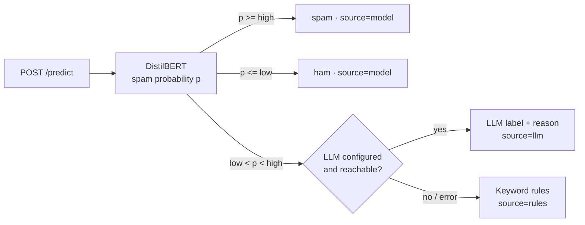

# Email Filtering Using DistilBERT


A hybrid spam filter served as a REST API. A fine-tuned DistilBERT model decides
the clear cases. Emails it is unsure about go to an LLM (Azure OpenAI or OpenAI)
for a second opinion, and keyword rules take over if the LLM is unavailable.

## How it works



- **Confidence band.** `low` and `high` are chosen during training on the
  validation set, so that the model's own decisions reach 99% precision for
  spam and 99% for ham. Only the remaining share of emails costs an LLM call.
- **LLM fallback.** Structured JSON output, temperature 0, timeout and retries,
  and an in-memory cache, so a repeated email is never paid for twice.
- **Rules.** A small set of phishing and scam patterns. Two or more matches mark
  an email as spam.
- **Same preprocessing in training and serving.** Both use `app/preprocessing.py`.

## Results

Filled in by `python -m training.train`, which writes `metrics.json` and
`thresholds.json` next to the model.

| Metric (validation set) | Value |
| --- | --- |
| Accuracy, model alone | _run training_ |
| F1 (spam), model alone | _run training_ |
| Confidence band | _run training_ |
| Share of emails sent to the LLM | _run training_ |

## Quick start

```bash
git clone https://github.com/namita-tj/Email-Filtering-Using-DistilBERT
cd Email-Filtering-Using-DistilBERT
cp .env.example .env          # add your credentials
```

**Train the model** (GPU recommended):
```bash
pip install -r requirements.txt -r training/requirements.txt
python -m training.train
```

**Run the API locally:**
```bash
uvicorn app.main:app --reload
```

**Or with Docker:**
```bash
docker compose up --build
```

Interactive docs: http://localhost:8000/docs

### Example

```bash
curl -X POST http://localhost:8000/predict \
  -H "Content-Type: application/json" \
  -d '{"subject": "Account locked", "text": "Verify your password within 24 hours."}'
```
Response shape (values depend on your trained model):
```json
{"label": "spam", "source": "llm", "spam_probability": 0.62, "reason": "Credential phishing attempt."}
```

## API

| Method | Path | Description |
| --- | --- | --- |
| POST | `/predict` | Body `{"subject": "...", "text": "..."}`. Returns `label`, `source`, `spam_probability`, `reason`. |
| GET | `/health` | Readiness, thresholds, and whether the LLM fallback is on. |

## Configuration

All settings are environment variables; see [`.env.example`](.env.example).
The model is loaded from `MODEL_DIR`, or downloaded from `S3_BUCKET` if the
folder is empty. The LLM provider is picked from the credentials you set, or
forced with `LLM_PROVIDER=azure|openai|none`.

## Development

```bash
pip install -r requirements-dev.txt   # no TensorFlow needed
ruff check .
pytest --cov
```

GitHub Actions runs lint and tests on every push and pull request, then builds
the Docker image and publishes it to GitHub Container Registry on `main`.

## Project structure

```
app/
  main.py           FastAPI app: /predict, /health
  pipeline.py       model -> LLM -> rules decision chain
  classifier.py     DistilBERT inference
  llm.py            Azure OpenAI / OpenAI fallback
  rules.py          keyword rules
  model_store.py    local model or S3 download
  preprocessing.py  text cleaning shared with training
  config.py         settings and thresholds
training/
  train.py          fine-tuning, metrics, threshold selection
  thresholds.py     confidence band selection
tests/              unit and API tests
```

## Dataset

[TrainingDataPro/email-spam-classification](https://huggingface.co/datasets/TrainingDataPro/email-spam-classification)
on Hugging Face, split 80/20 into training and validation.

## License

MIT
