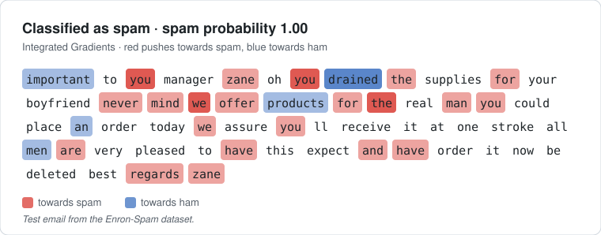
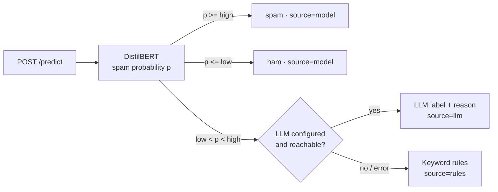

# Email Filtering Using DistilBERT


A hybrid, explainable spam filter served as a REST API. A fine-tuned DistilBERT
model decides the clear cases. Emails it is unsure about go to an LLM (Azure
OpenAI or OpenAI) for a second opinion, and keyword rules take over if the LLM is
unavailable. Every model decision can be explained word by word, and the
explanations are tested for faithfulness.

<p align="center">
  
</p>

## How it works



- **Confidence band.** `low` and `high` are chosen during training on the
  validation set, so that the model's own decisions reach 99% precision for
  spam and 99% for ham. Only the remaining share of emails costs an LLM call.
- **LLM fallback.** Structured JSON output, temperature 0, timeout and retries,
  and an in-memory cache, so a repeated email is never paid for twice.
- **Rules.** A small set of phishing and scam patterns. Two or more matches mark
  an email as spam.
- **Same preprocessing in training and serving.** Both use `app/preprocessing.py`.

## Explainability

**Integrated Gradients** (Sundararajan et al., 2017) attributes the spam
probability to each word, by integrating gradients along a path from a
neutral input (all words replaced by `[PAD]`) to the real email. Sub-word
tokens are merged back into words. Ask for it with `/predict?explain=true`.
It costs a few dozen extra forward and backward passes, so it is off by default.

Attention weights are deliberately not used as explanations: they show where
the model looks, not what changes its answer.

**Are the explanations true?** `python -m evaluation.run` checks them instead of
trusting them:

- **Completeness.** IG attributions must add up to the change in probability.
  The gap is reported as `convergence_delta` on every explanation.
- **Faithfulness** (ERASER deletion tests, DeYoung et al., 2020). Removing the
  top-k words should make the prediction collapse (comprehensiveness), and
  keeping only them should preserve it (sufficiency). Both are compared with
  removing k random words.
- **Shortcut audit.** Attributions are aggregated over the validation set to
  find words the model leans on that may not generalise: words found in only
  one class of this dataset, or stopwords and fragments among the most
  influential words. Flagged words are reviewed by hand.

## KPIs

`python -m evaluation.run` measures every KPI and writes a pass/miss report to
[`reports/kpis.md`](reports/kpis.md). Targets are starting points for a
production filter and are reviewed after the first full run.

| Group | KPI | Target | Why |
| --- | --- | ---: | --- |
| Quality | Legitimate emails marked as spam (false positive rate) | ≤ 1% | Losing a real email is the costliest error |
| Quality | Spam caught (recall) | ≥ 95% | Spam that never reaches the inbox |
| Quality | F1, full system / model alone | ≥ 95% | Balance of precision and recall |
| Hybrid design | Accuracy gain from the LLM on uncertain emails | ≥ 0 pp | The LLM must earn its cost |
| Hybrid design | Emails sent to the LLM | ≤ 15% | Most emails decided by the model |
| Hybrid design | Emails falling back to rules | ≤ 1% | Detects a failing LLM |
| Operations | Latency p95, model path / LLM path | ≤ 300 ms / ≤ 3 s | Responsiveness |
| Operations | LLM cost per 1,000 emails | ≤ $0.10 | Running cost |
| Explainability | IG completeness error | ≤ 0.05 | Attributions add up |
| Explainability | Top-5 comprehensiveness minus random | ≥ 0.10 | Explanations are faithful |
| Explainability | Explanations beating random (top-5) | ≥ 80% | Faithful for most emails |
| Explainability | Top-5 sufficiency | ≤ 0.20 | Explained words carry the decision |
| Explainability | Shortcut words | reviewed by hand | No reliance on dataset artifacts |

Engineering gates in CI: lint clean and test coverage ≥ 80%.

### Results

| KPI | Measured |
| --- | --- |
| False positive rate | _run evaluation_ |
| Spam recall | _run evaluation_ |
| F1, full system | _run evaluation_ |
| LLM gain on uncertain emails | _run evaluation_ |
| Emails sent to the LLM | _run evaluation_ |
| Top-5 comprehensiveness vs random | _run evaluation_ |

Detailed reports: [`reports/kpis.md`](reports/kpis.md),
[`reports/explainability.md`](reports/explainability.md),
[`reports/system.json`](reports/system.json).

## Quick start

```bash
git clone https://github.com/namita-tj/Email-Filtering-Using-DistilBERT
cd Email-Filtering-Using-DistilBERT
cp .env.example .env          # add your credentials
```

**Train the model** (GPU recommended):
```bash
pip install -r requirements.txt -r training/requirements.txt
python -m training.train
```

**Evaluate** quality, LLM routing, latency, cost and explanations against the KPIs
(writes `reports/` and `docs/explanation_example.svg`):
```bash
python -m evaluation.run                  # add --no-llm to skip API calls
python -m evaluation.run --fail-on-miss   # exit code 1 if a KPI misses, for pipelines
```

**Run the API locally:**
```bash
uvicorn app.main:app --reload
```

**Or with Docker:**
```bash
docker compose up --build
```

Interactive docs: http://localhost:8000/docs

### Example

```bash
curl -X POST http://localhost:8000/predict \
  -H "Content-Type: application/json" \
  -d '{"subject": "Account locked", "text": "Verify your password within 24 hours."}'
```
Response shape (values depend on your trained model):
```json
{"label": "spam", "source": "llm", "spam_probability": 0.62, "reason": "Credential phishing attempt.", "explanation": null}
```

With `?explain=true&top_k=3`, `explanation` holds the most influential words:
```json
{"method": "integrated_gradients", "spam_probability": 0.62, "convergence_delta": 0.004,
 "words": [{"word": "verify", "weight": 0.21}, {"word": "password", "weight": 0.17}, {"word": "hours", "weight": 0.06}]}
```

## API

| Method | Path | Description |
| --- | --- | --- |
| POST | `/predict` | Body `{"subject": "...", "text": "..."}`. Returns `label`, `source`, `spam_probability`, `reason`. Query `explain=true` adds word attributions, `top_k` (1-50) sets how many. |
| GET | `/health` | Readiness, thresholds, and whether the LLM fallback is on. |

## Configuration

All settings are environment variables; see [`.env.example`](.env.example).
The model is loaded from `MODEL_DIR`, or downloaded from `S3_BUCKET` if the
folder is empty. The LLM provider is picked from the credentials you set, or
forced with `LLM_PROVIDER=azure|openai|none`.

## Development

```bash
pip install -r requirements-dev.txt   # no TensorFlow needed
ruff check .
pytest --cov
```

GitHub Actions runs lint and tests on every push and pull request, then builds
the Docker image and publishes it to GitHub Container Registry on `main`.

## Project structure

```
app/
  main.py           FastAPI app: /predict, /health
  pipeline.py       model -> LLM -> rules decision chain
  classifier.py     DistilBERT inference and Integrated Gradients
  explain.py        word-level explanations
  llm.py            Azure OpenAI / OpenAI fallback
  rules.py          keyword rules
  model_store.py    local model or S3 download
  preprocessing.py  text cleaning shared with training
  config.py         settings and thresholds
training/
  train.py          fine-tuning, metrics, threshold selection
  thresholds.py     confidence band selection
  data.py           dataset loading and the shared split
evaluation/
  run.py            one command: system + explainability + KPI report
  system.py         end-to-end quality, LLM routing, latency, cost
  kpis.py           KPI definitions, targets, pass/miss report
  metrics.py        precision, recall, F1, FPR, percentiles, cost
  explainability.py IG completeness, faithfulness, shortcut audit
  faithfulness.py   ERASER comprehensiveness and sufficiency
  shortcut_audit.py words the model may rely on as shortcuts
  render.py         highlighted-email SVG for the README
  report.py         explainability Markdown report
tests/              unit and API tests
```

## Dataset

[TrainingDataPro/email-spam-classification](https://huggingface.co/datasets/TrainingDataPro/email-spam-classification)
on Hugging Face, split 80/20 into training and validation.

## License

MIT
