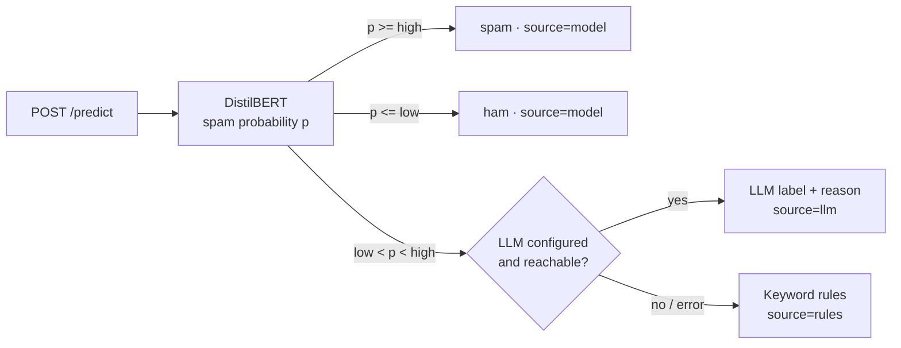

# Email Filtering Using DistilBERT


**When is a fine-tuned transformer worth it, and when is a simple model or an LLM enough?**
This project answers that for spam filtering, with measurements instead of assumptions.
It builds a hybrid, explainable spam filter served as a REST API (fine-tuned DistilBERT, an
LLM second opinion for uncertain emails, word-level explanations), then benchmarks it against
classical models and a free open-weight LLM on old and modern email.

## Key findings

| | Finding |
| --- | --- |
| 🎯 | **On the training-era data, simple models are just as good.** All four trained models reach F1 ≈ 0.99 on the Enron test set. Naive Bayes flags the fewest legitimate emails (0.8%) and trains in 16 seconds; DistilBERT (0.9%) needs 27 minutes on a GPU and is 20–30× slower per email. |
| ⚠️ | **Every model breaks on modern email, DistilBERT the most.** All of them still catch over 99% of modern phishing, but they also flag 23–25% of safe modern emails (classical) and **37% (DistilBERT)**. |
| 🔍 | **The explainability tooling found out why.** The shortcut audit shows the words pushing hardest towards "legitimate" are Enron names and jargon (*enron, vince, kaminski, daren, hpl*). The model learned "looks like Enron = safe". |
| 🤖 | **A small zero-shot LLM is not the fix.** Qwen2.5-3B-Instruct, run locally for free, catches spam but flags 47% of legitimate Enron emails and 74% of modern ones, at about 0.5 s per email. |
| 🧭 | **Confidence-based routing cannot catch distribution shift.** The LLM fallback is sent the emails the model is *unsure* about, but on modern email the model is *confidently wrong*. No email was routed to the LLM. |

**What I would deploy:** for this data, logistic regression or Naive Bayes behind the same API:
equally accurate, about 25× faster per email than DistilBERT and trained in seconds on a CPU.
The real bottleneck is data, not the model.
A filter for today's inbox needs recent training emails and a drift check (see [next steps](#next-steps)).

<p align="center">
  
</p>
<p align="center"><sub>Real output of the trained model (Integrated Gradients). Red words pushed towards spam, blue towards ham.
Much of the weight lands on common words like <i>you</i> and <i>the</i>, consistent with the faithfulness results below.</sub></p>

## How it works



- **Confidence band.** `low` and `high` are chosen on the validation split so that the
  model's own decisions reach 99% precision for spam and for ham. Only emails in between
  cost an LLM call. The test split is never used for tuning. On Enron the model already
  meets that target everywhere, so the band collapsed to a single cut-off (0.57).
- **LLM fallback.** Azure OpenAI or OpenAI with structured JSON output, temperature 0,
  timeout, retries and a cache, so a repeated email is never paid for twice.
- **Rules.** A small set of phishing and scam patterns; two or more matches mark spam.
- **No training/serving skew.** Training and the API share `app/preprocessing.py`.

## Benchmark

`python -m training.benchmark` scores every approach on **the same emails**: the 2,000-email
Enron-Spam test set and 2,000 emails from a modern phishing dataset (769 phishing, 1,231 safe)
that no model was trained on. Spam cut-off 0.5 for every model. Measured on a Colab T4 GPU.

| Approach | Enron F1 | Enron: legit flagged | Modern: legit flagged | Modern: spam caught | ms / email | Training |
| --- | ---: | ---: | ---: | ---: | ---: | ---: |
| Naive Bayes (word + bigram counts) | 0.990 | **0.8%** | 23.2% | 99.2% | 0.6 | 16 s |
| Linear SVM (TF-IDF) | 0.989 | 1.6% | 25.2% | 99.6% | 0.4 | 17 s |
| Logistic regression (TF-IDF) | 0.986 | 1.9% | **22.6%** | 99.5% | 0.4 | 18 s |
| DistilBERT, fine-tuned | **0.992** | 0.9% | 37.4% | 99.6% | 10.4 | ~27 min |

The zero-shot LLM is slow, so it ran on a random subset of 200 emails per test set, and every
model was scored on that same subset for a fair comparison:

| Approach (same 400-email subset) | Enron F1 | Enron: legit flagged | Modern: legit flagged | Modern: spam caught | ms / email |
| --- | ---: | ---: | ---: | ---: | ---: |
| Logistic regression (TF-IDF) | 0.981 | 3.1% | 18.2% | 98.7% | 0.4 |
| DistilBERT, fine-tuned | 0.986 | 2.1% | 38.0% | 98.7% | 9.7 |
| Qwen2.5-3B-Instruct, zero-shot, local | 0.817 | 46.9% | 74.4% | 97.5% | ~470 |

The LLM used the same prompt as the API fallback, unmodified, and cost nothing (it runs on the
GPU). A larger model or a tuned few-shot prompt would likely do better; this result matches
published findings that fine-tuned small models still beat zero-shot LLMs at classification.
Full numbers: [`reports/benchmark.md`](reports/benchmark.md).

## KPIs and results

`python -m evaluation.run` measures every KPI and writes a pass/miss report. Targets were set
before the first run. The false positive rate matters most: a legitimate email lost in the
spam folder costs far more than one spam email that slips through.

**9 pass · 3 miss · 3 to review · 2 not measured**

| Group | KPI | Target | Result | |
| --- | --- | ---: | ---: | --- |
| Quality | Legitimate emails marked as spam | ≤ 1% | 0.9% | ✅ |
| Quality | Spam caught (recall) | ≥ 95% | 99.2% | ✅ |
| Quality | F1, full system | ≥ 95% | 99.2% | ✅ |
| Quality | F1, model alone (validation) | ≥ 95% | 99.5% | ✅ |
| Hybrid design | Accuracy gain from the LLM on uncertain emails | ≥ 0 pp | – | no uncertain emails |
| Hybrid design | Emails sent to the LLM | ≤ 15% | 0.0% | ✅ |
| Hybrid design | Emails falling back to rules | ≤ 1% | 0.0% | ✅ |
| Operations | Latency p95, model path (T4 GPU, one email per request) | ≤ 300 ms | 165 ms | ✅ |
| Operations | Latency p95, LLM path | ≤ 3 s | – | no LLM calls |
| Operations | LLM cost per 1,000 emails | ≤ $0.10 | $0.00 | ✅ |
| Explainability | IG completeness error (mean) | ≤ 0.05 | 0.159 | ❌ |
| Explainability | Top-5 comprehensiveness minus random | ≥ 0.10 | 0.009 | ❌ |
| Explainability | Explanations beating random (top-5) | ≥ 80% | 57% | ❌ |
| Explainability | Top-5 sufficiency | ≤ 0.20 | 0.092 | ✅ |
| Explainability | Shortcut words | reviewed | 12 flagged | Enron names and jargon |
| Robustness | Modern phishing caught (out of distribution) | tracked | 99.6% | |
| Robustness | Safe modern emails marked as spam | tracked | 36.6% | the key weakness |

Reports: [`kpis.md`](reports/kpis.md) · [`explainability.md`](reports/explainability.md) ·
[`system.json`](reports/system.json) · [`system_phishing.json`](reports/system_phishing.json) ·
[`baseline.json`](reports/baseline.json) · [training metrics](reports/model/metrics.json)

## Explainability

**Integrated Gradients** (Sundararajan et al., 2017) attributes the spam probability to each
word by integrating gradients along a path from a neutral input (every word replaced by
`[PAD]`) to the real email. Sub-word tokens are merged back into words. It is requested with
`/predict?explain=true`. Attention weights are deliberately not used: they show where the
model looks, not what changes its answer.

The explanations are tested, not trusted, and the tests found real limits:

- **Completeness** (attributions should add up to the change in probability): mean error
  0.16 against a 0.05 target. With 32 integration steps the approximation is too coarse.
- **Faithfulness** (ERASER, DeYoung et al., 2020): removing the top-5 words lowers the
  prediction only slightly more than removing 5 random words (0.019 vs 0.010), while keeping
  only those 5 words preserves most of it (sufficiency 0.09, passes). The model is so
  confident (probabilities near 0 or 1) that deleting a few words barely moves it.
- **Shortcut audit**: the strongest "legitimate" signals are *enron, daren, hourahead, hpl,
  vince, kaminski*: names and jargon that appear only in legitimate Enron email. This is the
  shortcut that explains the false alarms on modern email.

## Limitations

- Trained on Enron (early 2000s). It does not reflect today's legitimate email, as the
  robustness results show.
- The zero-shot LLM was a 3B model with an unmodified prompt on 400 emails; it is a fair
  lower bound, not the best an LLM can do.
- The LLM fallback path is implemented and unit-tested, but no email fell in the uncertain
  band, so its live accuracy, latency and cost are unmeasured.
- Explanation faithfulness misses its targets (see above).
- Latencies were measured on a Colab T4 GPU; CPU serving will be slower for DistilBERT.

## Next steps

1. Retrain on a mix of Enron and recent email, then rerun the benchmark: the clearest way to
   reduce the 23–37% false alarms on modern email.
2. Route by drift, not only by confidence: send emails that look unlike the training data
   to the LLM.
3. Re-test zero-shot with a larger open model (7–8B) and a few-shot prompt.
4. Integrated Gradients with more steps and faithfulness measured in logit space.
5. A public demo (Hugging Face Space) with the model on the Hugging Face Hub.

## Quick start

```bash
git clone https://github.com/namita-tj/Email-Filtering-Using-DistilBERT
cd Email-Filtering-Using-DistilBERT
cp .env.example .env          # add your credentials
```

**Easiest: Google Colab.** Upload [`notebooks/train_and_evaluate.ipynb`](notebooks/train_and_evaluate.ipynb)
(training and every KPI, ~40 min on a free T4) and [`notebooks/benchmark.ipynb`](notebooks/benchmark.ipynb)
(the benchmark, including the local LLM, ~15 min). Neither needs an API key.

**Or locally** (Python 3.12/3.13; a GPU helps):
```bash
pip install -r requirements.txt -r training/requirements.txt
python -m training.train                  # full Enron-Spam training set
TRAIN_LIMIT=2000 python -m training.train # quick trial run
python -m training.baseline               # TF-IDF baseline, CPU, under a minute
python -m evaluation.run --phishing       # all KPIs; add --no-llm to skip API calls
python -m training.benchmark --local-llm Qwen/Qwen2.5-3B-Instruct   # benchmark (needs PyTorch)
```
Training downloads Enron-Spam from Hugging Face and saves the model, `metrics.json` and
`thresholds.json` to `spam_detection_model/`. `MAX_LENGTH` (default 256 tokens) and
`EPOCHS` (default 2) are environment variables.

**Serve** locally or with Docker:
```bash
uvicorn app.main:app --reload
# or
docker compose up --build
```
Interactive API docs: http://localhost:8000/docs

## API

| Method | Path | Description |
| --- | --- | --- |
| POST | `/predict` | Classify an email. Body `{"subject": "...", "text": "..."}`. Query `explain=true` adds word attributions, `top_k` (1–50) sets how many. |
| GET | `/health` | Readiness, thresholds, and whether the LLM fallback is on. |

```bash
curl -X POST "http://localhost:8000/predict?explain=true&top_k=3" \
  -H "Content-Type: application/json" \
  -d '{"subject": "Account locked", "text": "Verify your password within 24 hours."}'
```

Response shape (values depend on the trained model):
```json
{
  "label": "spam",
  "source": "model",
  "spam_probability": 0.98,
  "reason": null,
  "explanation": {
    "method": "integrated_gradients",
    "spam_probability": 0.98,
    "convergence_delta": 0.012,
    "words": [
      {"word": "verify", "weight": 0.21},
      {"word": "password", "weight": 0.17},
      {"word": "hours", "weight": 0.06}
    ]
  }
}
```

`source` tells you which stage decided (`model`, `llm` or `rules`). The explanation always
describes the DistilBERT score.

## Configuration

All settings are environment variables; [`.env.example`](.env.example) lists them all.

| Variable | Purpose |
| --- | --- |
| `MODEL_DIR` | Folder with the trained model (default `spam_detection_model`) |
| `S3_BUCKET`, `S3_PREFIX` | Where to download the model from if `MODEL_DIR` is empty |
| `LLM_PROVIDER` | `azure`, `openai` or `none`; picked from the credentials if left empty |
| `AZURE_OPENAI_ENDPOINT`, `AZURE_OPENAI_API_KEY`, `AZURE_OPENAI_DEPLOYMENT` | Azure OpenAI fallback |
| `OPENAI_API_KEY`, `OPENAI_MODEL` | OpenAI API fallback (default model `gpt-4o-mini`) |
| `LOW_THRESHOLD`, `HIGH_THRESHOLD` | Override the confidence band from training |
| `LLM_TIMEOUT_SECONDS`, `LOG_LEVEL` | Timeout for LLM calls, log verbosity |

## Development

```bash
pip install -r requirements-dev.txt   # no TensorFlow or PyTorch needed
ruff check .
pytest --cov
```

Unit and API tests use stand-ins for the model and the LLM, so they run in seconds without a
GPU or API keys. Tests for the local LLM run when PyTorch is installed and are skipped
otherwise. GitHub Actions runs lint and tests (coverage must stay at or above 80%) on every
push and pull request, then builds the Docker image and publishes it to GitHub Container
Registry on `main`. A manual workflow trains and evaluates a small model on CPU.

## Project status

- [x] Hybrid API with LLM fallback and rules
- [x] Docker image and CI/CD
- [x] Explainability with faithfulness tests and shortcut audit
- [x] KPI evaluation and report
- [x] Training run and published results
- [x] Benchmark against classical models and a zero-shot open-weight LLM
- [ ] Retraining on recent email (see [next steps](#next-steps))
- [ ] Public demo

## Project structure

```
app/                FastAPI service
  main.py           /predict and /health
  pipeline.py       model -> LLM -> rules decision chain
  classifier.py     DistilBERT inference and Integrated Gradients
  explain.py        word-level explanations
  llm.py            Azure OpenAI / OpenAI fallback
  local_llm.py      zero-shot open-weight LLM on a local GPU (benchmark)
  rules.py          keyword rules
  model_store.py    local model or S3 download
  preprocessing.py  text cleaning shared with training
  config.py         settings and thresholds
training/
  train.py          fine-tuning, metrics, threshold selection
  thresholds.py     confidence band selection
  data.py           Enron-Spam and phishing loaders, train/validation/test split
  baseline.py       TF-IDF + logistic regression baseline
  benchmark.py      classical models vs DistilBERT vs zero-shot LLM on the same emails
evaluation/
  run.py            one command: system + explainability + KPI report
  system.py         end-to-end quality, LLM routing, latency, cost
  kpis.py           KPI definitions, targets, pass/miss report
  metrics.py        precision, recall, F1, FPR, percentiles, cost
  explainability.py IG completeness, faithfulness, shortcut audit
  faithfulness.py   ERASER comprehensiveness and sufficiency
  shortcut_audit.py words the model may rely on as shortcuts
  render.py         highlighted-email SVG for this README
  report.py         explainability Markdown report
notebooks/          Colab notebooks: train + evaluate, benchmark
reports/            measured results (KPIs, explainability, benchmark, training metrics)
tests/              unit and API tests
```

## Tech stack

Python · TensorFlow · Hugging Face Transformers · PyTorch · scikit-learn · FastAPI · Pydantic ·
Azure OpenAI / OpenAI · Qwen2.5 (open weights) · AWS S3 · Docker · GitHub Actions · pytest · Ruff

## Datasets

| Use | Dataset | Size | Notes |
| --- | --- | ---: | --- |
| Train, validation, test | [Enron-Spam](https://huggingface.co/datasets/SetFit/enron_spam) (Metsis et al., 2006) | 31.7k train, 2k test | Real spam and business email with subject and body. 10% of the train split is held out for validation. Also available as a CSV from [MWiechmann/enron_spam_data](https://github.com/MWiechmann/enron_spam_data) (GPL-3.0): `python -m training.baseline --enron-csv enron_spam_data.csv`. |
| Out-of-distribution test | [Phishing Email Detection](https://huggingface.co/datasets/zefang-liu/phishing-email-dataset) (Kaggle, mirrored on Hugging Face) | 18.7k (2,000 sampled) | Modern phishing and safe emails, body only. Never used for training. LGPL-3.0. |

Empty emails and placeholder texts such as "empty" or "null" are removed, and very long
emails are cut at 20,000 characters, the same limit the API uses.

## Author

**Namita Thangavel Jeyaradha** · [GitHub](https://github.com/namita-tj)

## License

MIT
