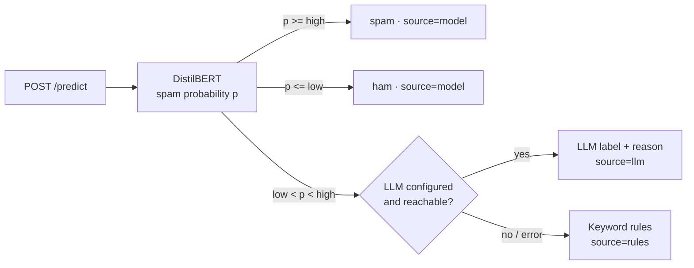

# Email Filtering Using DistilBERT


**A hybrid, explainable spam filter served as a REST API.** A fine-tuned DistilBERT
model decides the clear cases, an LLM gives a second opinion on the uncertain
ones, and every decision can be explained word by word, with the explanations
themselves tested for faithfulness.

<p align="center">
  
</p>
<p align="center"><sub>Integrated Gradients attributions: red words pushed the model towards spam, blue towards ham.</sub></p>

## Highlights

- **Hybrid decision chain.** DistilBERT → Azure OpenAI / OpenAI for uncertain emails → keyword rules if the LLM is unavailable.
- **Calibrated routing.** The confidence band is chosen on validation data, so the LLM is only paid for where the model is unsure.
- **Explainable AI.** Word-level Integrated Gradients via `?explain=true`, checked with ERASER faithfulness tests and a shortcut audit.
- **Measured against 15 KPIs.** Quality, LLM value, latency, cost and explanation faithfulness, with a pass/miss report.
- **Production basics.** FastAPI with validation, Docker, CI with lint, tests and an 80% coverage gate, image published to GHCR.

## How it works



- **Confidence band.** `low` and `high` are chosen during training so that the
  model's own decisions reach 99% precision for spam and for ham on the
  validation set. Only emails in between cost an LLM call.
- **LLM fallback.** Structured JSON output, temperature 0, timeout and retries,
  and a cache, so a repeated email is never paid for twice.
- **Rules.** A small set of phishing and scam patterns; two or more matches mark
  an email as spam.
- **No training/serving skew.** Training and the API share `app/preprocessing.py`.

## Explainability

**Integrated Gradients** (Sundararajan et al., 2017) attributes the spam
probability to each word by integrating gradients along a path from a neutral
input (every word replaced by `[PAD]`) to the real email. Sub-word tokens are
merged back into words. It costs a few dozen extra forward and backward passes,
so it is off by default and requested with `/predict?explain=true`.

Attention weights are deliberately not used as explanations: they show where the
model looks, not what changes its answer.

The explanations are tested, not trusted:

- **Completeness.** IG attributions must add up to the change in probability.
  The gap is returned as `convergence_delta` with every explanation.
- **Faithfulness** (ERASER, DeYoung et al., 2020). Removing the top-k words should
  make the prediction collapse (comprehensiveness); keeping only them should
  preserve it (sufficiency). Both are compared with removing k random words.
- **Shortcut audit.** Attributions are aggregated over the validation set to find
  words the model may lean on without them generalising: words found in only one
  class of this dataset, or stopwords and fragments among the most influential
  words. Flagged words are reviewed by hand.

## KPIs and results

`python -m evaluation.run` measures every KPI and writes a pass/miss report to
[`reports/kpis.md`](reports/kpis.md). The false positive rate matters most: a
legitimate email lost in the spam folder costs far more than one spam email that
slips through. Targets are starting points and are reviewed after the first run.

| Group | KPI | Target | Result |
| --- | --- | ---: | ---: |
| Quality | Legitimate emails marked as spam | ≤ 1% | _pending_ |
| Quality | Spam caught (recall) | ≥ 95% | _pending_ |
| Quality | F1, full system | ≥ 95% | _pending_ |
| Quality | F1, model alone | ≥ 95% | _pending_ |
| Hybrid design | Accuracy gain from the LLM on uncertain emails | ≥ 0 pp | _pending_ |
| Hybrid design | Emails sent to the LLM | ≤ 15% | _pending_ |
| Hybrid design | Emails falling back to rules | ≤ 1% | _pending_ |
| Operations | Latency p95, model path | ≤ 300 ms | _pending_ |
| Operations | Latency p95, LLM path | ≤ 3 s | _pending_ |
| Operations | LLM cost per 1,000 emails | ≤ $0.10 | _pending_ |
| Explainability | IG completeness error (mean) | ≤ 0.05 | _pending_ |
| Explainability | Top-5 comprehensiveness minus random | ≥ 0.10 | _pending_ |
| Explainability | Explanations beating random (top-5) | ≥ 80% | _pending_ |
| Explainability | Top-5 sufficiency | ≤ 0.20 | _pending_ |
| Explainability | Shortcut words | reviewed | _pending_ |

Detailed reports: [`reports/kpis.md`](reports/kpis.md) ·
[`reports/explainability.md`](reports/explainability.md) ·
[`reports/system.json`](reports/system.json)

## Quick start

```bash
git clone https://github.com/namita-tj/Email-Filtering-Using-DistilBERT
cd Email-Filtering-Using-DistilBERT
cp .env.example .env          # add your credentials
```

**1. Train** (a GPU helps; Google Colab works well):
```bash
pip install -r requirements.txt -r training/requirements.txt
python -m training.train
```
Saves the model, `metrics.json` and `thresholds.json` to `spam_detection_model/`.

**2. Evaluate** against the KPIs (writes `reports/` and the README image):
```bash
python -m evaluation.run                  # --no-llm skips API calls
python -m evaluation.run --fail-on-miss   # exit code 1 if a KPI misses, for pipelines
```

**3. Serve** locally or with Docker:
```bash
uvicorn app.main:app --reload
# or
docker compose up --build
```
Interactive API docs: http://localhost:8000/docs

## API

| Method | Path | Description |
| --- | --- | --- |
| POST | `/predict` | Classify an email. Body `{"subject": "...", "text": "..."}`. Query `explain=true` adds word attributions, `top_k` (1–50) sets how many. |
| GET | `/health` | Readiness, thresholds, and whether the LLM fallback is on. |

```bash
curl -X POST "http://localhost:8000/predict?explain=true&top_k=3" \
  -H "Content-Type: application/json" \
  -d '{"subject": "Account locked", "text": "Verify your password within 24 hours."}'
```

Response shape (values depend on the trained model):
```json
{
  "label": "spam",
  "source": "llm",
  "spam_probability": 0.62,
  "reason": "Credential phishing attempt.",
  "explanation": {
    "method": "integrated_gradients",
    "spam_probability": 0.62,
    "convergence_delta": 0.004,
    "words": [
      {"word": "verify", "weight": 0.21},
      {"word": "password", "weight": 0.17},
      {"word": "hours", "weight": 0.06}
    ]
  }
}
```

`source` tells you which stage decided (`model`, `llm` or `rules`). The
explanation always describes the DistilBERT score.

## Configuration

All settings are environment variables; [`.env.example`](.env.example) lists them all.

| Variable | Purpose |
| --- | --- |
| `MODEL_DIR` | Folder with the trained model (default `spam_detection_model`) |
| `S3_BUCKET`, `S3_PREFIX` | Where to download the model from if `MODEL_DIR` is empty |
| `LLM_PROVIDER` | `azure`, `openai` or `none`; picked from the credentials if left empty |
| `AZURE_OPENAI_ENDPOINT`, `AZURE_OPENAI_API_KEY`, `AZURE_OPENAI_DEPLOYMENT` | Azure OpenAI fallback |
| `OPENAI_API_KEY`, `OPENAI_MODEL` | OpenAI API fallback (default model `gpt-4o-mini`) |
| `LOW_THRESHOLD`, `HIGH_THRESHOLD` | Override the confidence band from training |
| `LLM_TIMEOUT_SECONDS`, `LOG_LEVEL` | Timeout for LLM calls, log verbosity |

## Development

```bash
pip install -r requirements-dev.txt   # no TensorFlow needed
ruff check .
pytest --cov
```

Unit and API tests use stand-ins for the model and the LLM, so they run in
seconds without a GPU or API keys. GitHub Actions runs lint and tests (coverage
must stay at or above 80%) on every push and pull request, then builds the Docker
image and publishes it to GitHub Container Registry on `main`.

## Project status

- [x] Hybrid API with LLM fallback and rules
- [x] Docker image and CI/CD
- [x] Explainability with faithfulness tests and shortcut audit
- [x] KPI evaluation and report
- [ ] Training run and published results
- [ ] Deployment to Azure Container Apps with a public demo

## Project structure

```
app/                FastAPI service
  main.py           /predict and /health
  pipeline.py       model -> LLM -> rules decision chain
  classifier.py     DistilBERT inference and Integrated Gradients
  explain.py        word-level explanations
  llm.py            Azure OpenAI / OpenAI fallback
  rules.py          keyword rules
  model_store.py    local model or S3 download
  preprocessing.py  text cleaning shared with training
  config.py         settings and thresholds
training/
  train.py          fine-tuning, metrics, threshold selection
  thresholds.py     confidence band selection
  data.py           dataset loading and the shared split
evaluation/
  run.py            one command: system + explainability + KPI report
  system.py         end-to-end quality, LLM routing, latency, cost
  kpis.py           KPI definitions, targets, pass/miss report
  metrics.py        precision, recall, F1, FPR, percentiles, cost
  explainability.py IG completeness, faithfulness, shortcut audit
  faithfulness.py   ERASER comprehensiveness and sufficiency
  shortcut_audit.py words the model may rely on as shortcuts
  render.py         highlighted-email SVG for this README
  report.py         explainability Markdown report
tests/              unit and API tests
```

## Tech stack

Python · TensorFlow · Hugging Face Transformers · FastAPI · Pydantic · Azure OpenAI / OpenAI ·
AWS S3 · Docker · GitHub Actions · pytest · Ruff

## Dataset

[TrainingDataPro/email-spam-classification](https://huggingface.co/datasets/TrainingDataPro/email-spam-classification)
on Hugging Face, split 80/20 into training and validation with a fixed seed.

## Author

**Namita Thangavel Jeyaradha** · [GitHub](https://github.com/namita-tj)

## License

MIT
